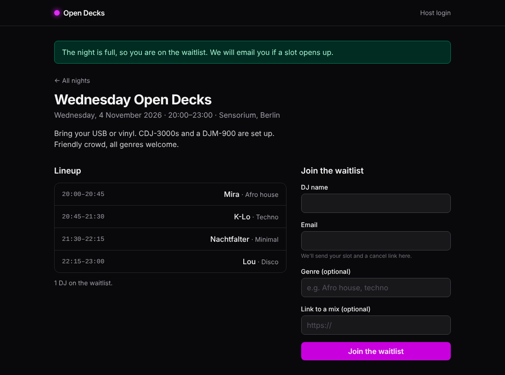
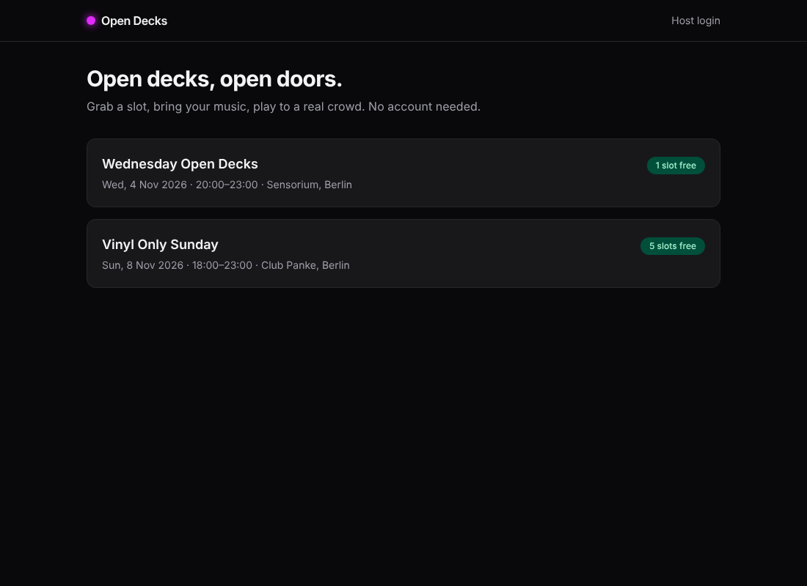
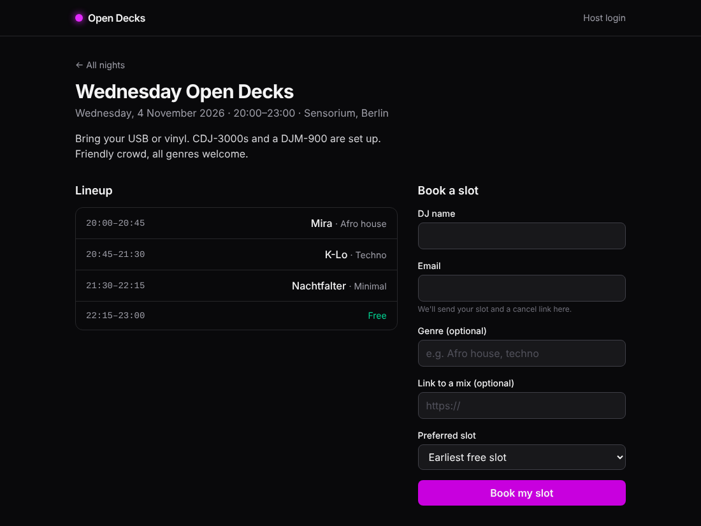
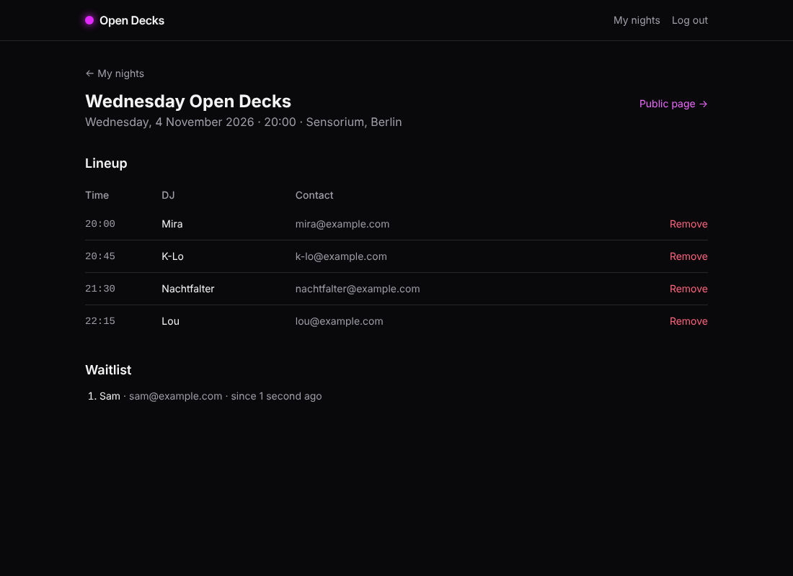
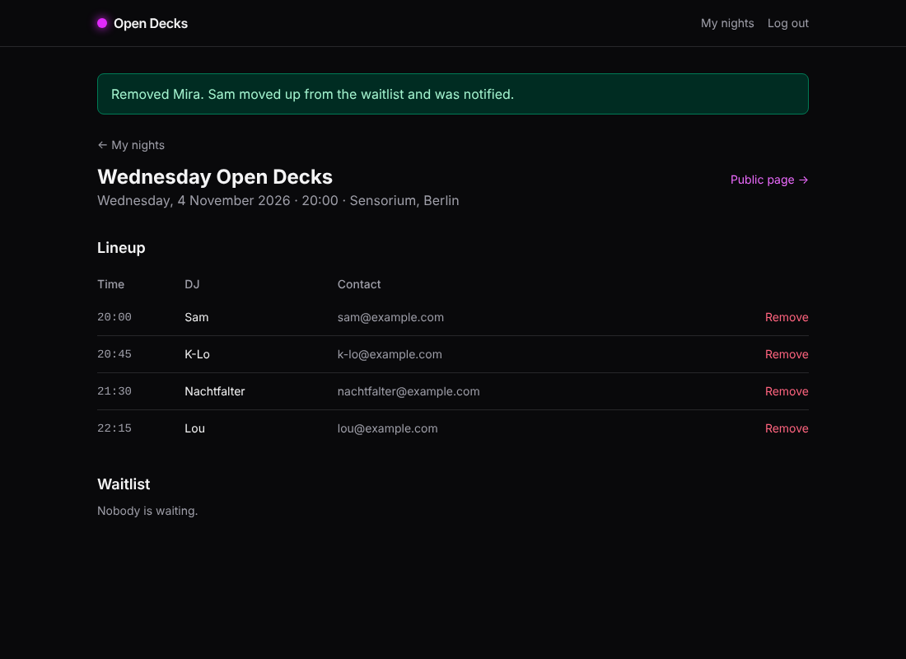

# Open Decks

[](https://github.com/ankitvij/open-decks/actions/workflows/tests.yml)

Slot booking for open-decks DJ nights. A host publishes a night with a fixed number of equally long slots. DJs pick a slot without creating an account. When the night is full, new DJs go onto a waitlist. When someone cancels, the first DJ on the waitlist moves up automatically and gets an email.



## Getting started

Requirements: PHP 8.2+, Composer, Node 20+, SQLite.

```bash
git clone https://github.com/ankitvij/open-decks.git
cd open-decks
composer setup          # install, .env, app key, migrations, npm build
php artisan db:seed     # two demo nights with a few DJs already booked
php artisan serve
```

Open http://127.0.0.1:8000.

- **As a DJ:** open a night, enter a name and email, and pick a slot (or let the app choose the earliest one).
- **As the host:** log in with `host@example.com` / `password`. You can create nights, see contact details and the waitlist, and remove a DJ.

Mail goes to the log driver, so confirmation and cancel links appear in `storage/logs/laravel.log`.

Run the checks:

```bash
vendor/bin/phpunit
vendor/bin/pint --test
```

## The idea

Open-decks nights in Berlin bars are usually organised through Instagram DMs and a spreadsheet. The host loses track of who confirmed, no-shows leave gaps, and nobody knows who's next when someone drops out. This app does one thing: a fair, first-come-first-served lineup that refills itself.

| | |
|---|---|
|  |  |
|  |  |

## How it works

1. A host creates a night, for example 20:00, 4 slots of 45 minutes. `CreateNight` generates the slots back to back.
2. A DJ books a slot. `RequestSlot` creates the booking and tries to claim the chosen slot or the first free one. If no slot is free, the booking stays `waitlisted`.
3. The DJ gets an email with the slot time and a signed cancel link.
4. When the DJ cancels via the link, or the host removes them, `CancelBooking` frees the slot and immediately hands it to the first DJ on the waitlist. That DJ gets a "a slot opened up" email.

## Architecture decisions

- **Slot claiming with a conditional UPDATE instead of locks.** `SlotClaimer::claim()` runs `UPDATE slots SET booking_id = ? WHERE id = ? AND booking_id IS NULL` and checks whether exactly one row changed. When two DJs race for the last slot, the database lets exactly one of them win. This works the same on SQLite, MySQL and Postgres without `SELECT … FOR UPDATE`. A unique index on `slots.booking_id` is the second safety net, so one booking can never hold two slots.
- **Slots are rows, not a computed schedule.** Storing each slot makes "who plays at 21:30" a simple join, keeps the uniqueness rule in the database, and leaves room for slots of different lengths later.
- **Actions for business logic.** `RequestSlot`, `CancelBooking`, `CreateNight` and `SlotClaimer` hold the rules. Controllers only validate input (Form Requests), authorise and redirect. The same action is used by the public cancel link and by the host's "Remove" button, so both paths promote the waitlist the same way.
- **No accounts for DJs.** A booking is identified by a signed, expiring URL (`URL::temporarySignedRoute`). The link expires when the night starts. The GET request only shows a confirmation page; the cancel itself is a POST, so link previews in mail clients can't cancel a booking.
- **Authorisation through a policy.** `NightPolicy::manage` allows hosts to see and change only their own nights. Removing a booking also checks that it belongs to the night in the URL (404 otherwise).
- **Booking status as an enum** (`confirmed`, `waitlisted`, `cancelled`) with a `cancelled_at` timestamp. Cancelled bookings stay in place for history, and the same email can book again after cancelling.
- **No N+1 on lineups.** `Night::slots()` uses `chaperone()`, so each slot already knows its night without extra queries.

## Quality checks

- **33 feature tests (110 assertions)** covering:
  - booking and the waitlist, and duplicate emails (case-insensitive)
  - closed and unpublished nights, and validation
  - signed and tampered cancel links, link expiry, and cancelling twice
  - waitlist order on promotion
  - host authorisation
  - mail content
  - the race on the conditional UPDATE: a second claim on a taken slot returns `false`
- **Laravel Pint** for code style.
- **GitHub Actions:** Pint plus the test suite on PHP 8.2, 8.3 and 8.4 (`.github/workflows/tests.yml`).
- **Click-through in a real browser (Playwright)**: booking the last slot, joining the waitlist, the host removing a DJ, and the waitlist moving up. The screenshots above come from that run.
- **Bugs found while building:**
  - A freshly created `Night` had `is_published = null` in memory and refused bookings until it was reloaded. Fixed with a model default and a regression test.
  - The host page had a `confirm()` dialog that interpolated the DJ name into JavaScript (an XSS risk). Replaced with a fixed text.

## Use of AI

I built this with Claude Code (Anthropic) as a pair programmer. I set the scope and the architecture decisions above. Claude wrote most of the first drafts of the code and tests. I reviewed every change, ran the app myself and pushed back where it was wrong. The two bugs listed above were caught in that review and test loop. I treat AI output like a pull request from a fast junior colleague: helpful, but nothing gets merged without reading and tests.

## Known limits

- **Duplicate-email check is app-level.** Two simultaneous requests with the same email could both pass. A partial unique index (`night_id, email WHERE status != 'cancelled'`) would close the gap, but it isn't portable to MySQL. The slot itself can never be double-booked.
- **Mails are sent synchronously.** In production they would implement `ShouldQueue`.
- **Simple auth.** Session login for hosts with no registration, password reset or 2FA; hosts are created via the seeder or tinker. Laravel Breeze or Fortify would be the next step.
- **Fixed slot length per night.** No drag-and-drop reordering or custom slot lengths yet.
- **No time-zone handling.** All times use `APP_TIMEZONE` (Europe/Berlin).
- **Not production-hardened.** SQLite is used for the demo, and there's no rate limiting beyond `throttle:10,1` on bookings, no spam protection (captcha) and no monitoring.
- **No `composer.lock` committed.** CI resolves the latest compatible versions.
